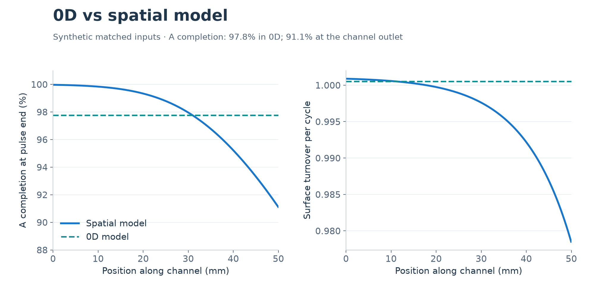
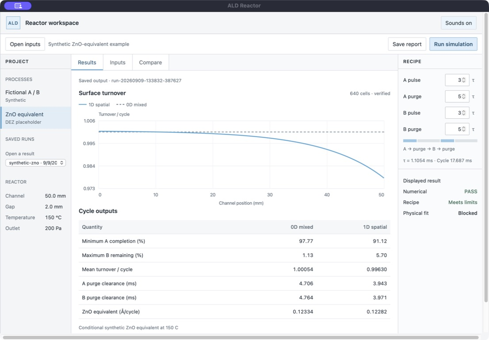
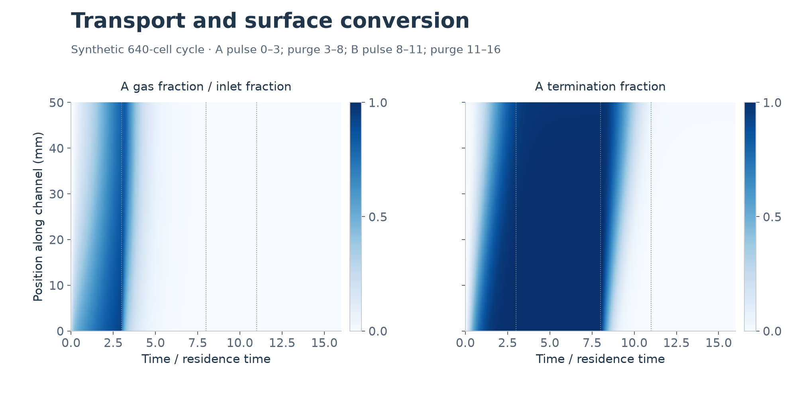
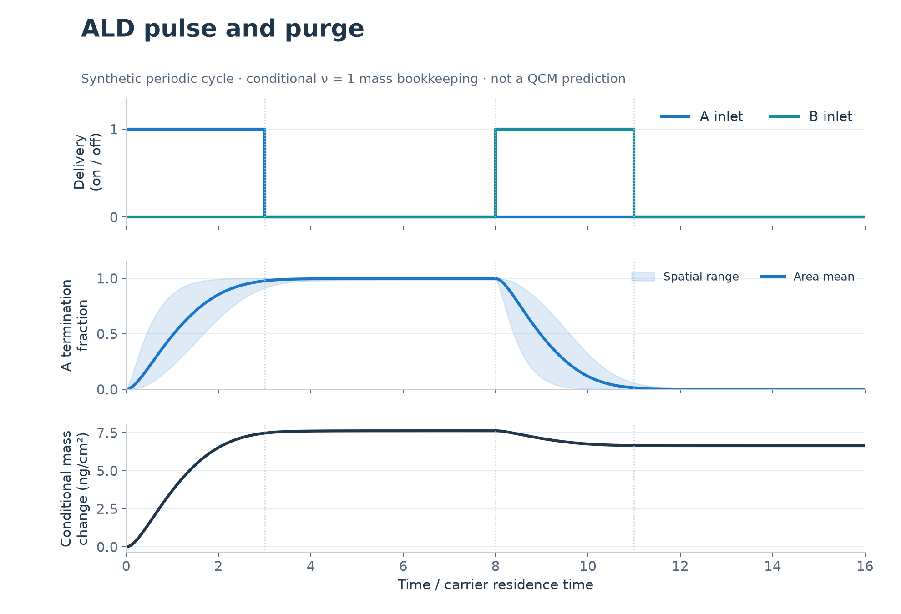

# ALD reactor digital twin

<p align="center"><a href="#overview">Overview</a> · <a href="#install">Install</a> · <a href="#usage">Usage</a> · <a href="#results">Results</a> · <a href="#limits">Limits</a> · <a href="#next-steps">Next steps</a> · <a href="#guides-and-sources">Guides and sources</a> · <a href="#license">License</a> · <a href="#terms">Terms</a></p>

Given the same simulated gas pulses, one reactor model predicted that 97.8% of surface sites would finish the first reaction. A second model followed the gas down the channel and predicted 91.1% at the outlet. The first model assigns the same gas concentration everywhere. It has no way to show which end received less precursor.

## Key results

- **Recipe study.** I tested 63 synthetic combinations of pulse timings and reactor conditions. Every simulation passed the numerical checks. No recipe delivered enough precursor and cleared enough residual gas across every scenario.
- **Zinc oxide example.** Published surface and film properties give an estimated 1.68 Å per cycle at full coverage. The reported value at 150 °C is 1.65 Å. The model’s diffusion check flags the 2 mm channel used in this example.
- **Software checks.** The 22 Python tests include hand-calculated fluxes, analytical diffusion and purge solutions, and cycle mass conservation. Seven JavaScript tests cover desktop state and saved results.



## Overview

In atomic layer deposition (ALD), two gases react with a surface in turn. A purge between pulses clears leftover gas. The surface can keep what it picked up from the first pulse while the chamber fills with the second gas.

I built the two models in Python so I could change how they represent gas delivery while keeping the chemistry and pulse timings fixed. One model mixes the chamber instantly. The other divides the channel into cells and accounts for gas moving between them.

> [!NOTE]
> <sub>atomic layer deposition (ALD): growing a film through repeated gas exposures · precursor: gas that carries the film's atoms · purge: flushing gas out of the reactor · half-reaction: one precursor reacting with the surface · 0D model: treats the reactor as one well-mixed volume · spatial model: tracks gas along the channel</sub>

## Install

The desktop app is packaged for Apple Silicon Macs.

[Download for Apple Silicon Mac](https://github.com/mehnajjimy/ald-reactor-digital-twin/releases/download/v1.0.0/ALD-Reactor-1.0.0-macOS-arm64.zip) · [Install guide](docs/install.md)

The app has only been tested on Apple Silicon Macs. It isn't notarized by Apple, so macOS will block it the first time. The install guide shows how to open it anyway.



To run from source you need Python 3.12. On macOS or Linux:

```sh
python3.12 -m venv .venv
.venv/bin/python -m pip install -r requirements-lock.txt
.venv/bin/python -m pip install --no-build-isolation --no-deps -e .
.venv/bin/ald-twin gui
```

I've only tested the Mac app on my own machine, and Windows builds aren't verified. [Installation](docs/installation.md) and the [desktop guide](docs/desktop-guide.md) cover setup and builds.

Sources: docs/install.md, docs/installation.md, docs/desktop-guide.md, pyproject.toml, requirements-lock.txt

## Usage

Run an example from the command line:

```sh
.venv/bin/ald-twin inspect synthetic-ab
OPENBLAS_NUM_THREADS=1 VECLIB_MAXIMUM_THREADS=1 .venv/bin/ald-twin simulate synthetic-ab --output runs/first-ab
.venv/bin/ald-twin compare runs/first-ab
```

The app, the CLI and the Python API all use the same solver. Every run saves its inputs, results and a hash of the code that made them, so you can always tell where a number came from. The fictional A/B example only reports surface turnover, since there's no real film to convert it into.

Sources: src/ald_twin/, docs/worked-examples.md, docs/input-reference.md

## Results

> [!IMPORTANT]
> Two of the examples use made-up numbers to test the math. The third, ZnO from DEZ and water, uses published estimates plus a couple of assumptions. None of them has been checked against real experiments yet.

> [!NOTE]
> <sub>completion: share of the surface that reacts in a half-reaction · turnover: completed surface cycles per site, each cycle · outlet: the far end of the channel · QCM: quartz crystal microbalance, a way to weigh a film as it grows · Péclet number: how much faster flow carries gas than diffusion spreads it · DEZ: diethylzinc · ZnO: zinc oxide · Å: angstrom, a ten-billionth of a meter</sub>

### Model comparison

At the end of the first pulse, the channel calculation can report the fraction of sites that reacted at each position. Comparing its outlet value with the well-mixed prediction gives a gap of 6.7 percentage points in the saved example.



Follow one position through the purge. The gas concentration falls while the surface keeps its reacted sites until the next precursor arrives.

[How the figures were made](docs/readme-figures.md)

Sources: docs/media/model-comparison.png, docs/media/provenance.json, docs/readme-figures.md, scripts/render_readme_figures.py

### Cycle behavior

The saved cycle below puts gas delivery, site conversion and the calculated mass change on the same time axis. The mass trace uses assumed chemistry. Comparison with a quartz crystal microbalance would require experimental data.



[How the figures were made](docs/readme-figures.md)

Sources: docs/media/ald-cycle.png, docs/media/synthetic-cycle.npz, docs/media/provenance.json, docs/readme-figures.md

### Recipe study

The recipe study varied pulse and purge times across 63 recipe and scenario pairs. At the end of the A pulse, at least 90% of the sites in every active cell had to carry A. At the end of the B pulse, at most 10% could still carry A. After each purge, the combined precursor mole fraction throughout the channel had to be at most 1% of the model’s reference mole fraction. Inspecting the numerical checks alone would have missed failures on those criteria.

> [!IMPORTANT]
> No recipe met all three conditions in every scenario. Nine earlier high-Péclet cases and one surface-capacity point remain numerically unverified.

[Full analysis](docs/recipe-study.md)

Sources: docs/model-limits.md, docs/process-study-plan.md

### DEZ example

The `dez-water-zno` example estimates zinc oxide growth from published values for site capacity and film density. At full coverage those inputs give 1.68 Å per cycle, compared with a published 1.65 Å per cycle at 150 °C.

> [!WARNING]
> Both reaction probabilities are assumed. In the example’s 2 mm gap, DEZ diffuses across the channel too slowly for the model’s wall-delivery assumption. The thickness comparison cannot establish that the simulated surface actually reaches full coverage.

The example takes about 13 minutes to run from source. The packaged 1.0.0 app predates this example.

```sh
OPENBLAS_NUM_THREADS=1 VECLIB_MAXIMUM_THREADS=1 .venv/bin/ald-twin simulate dez-water-zno --output runs/dez
```

[Full analysis](docs/dez-example.md) · [Input reference](docs/input-reference.md#the-dez-and-water-estimates)

Sources: src/ald_twin/processes/dez-water-zno.json, docs/input-reference.md, tests/test_dez_estimates.py

## Limits

- None of the examples has been checked against real experiments. Two use
  made-up numbers, and the DEZ example still assumes both reaction probabilities.
- The 97.8% against 91.1% gap at the top comes from synthetic inputs. It's a
  model result that I haven't measured on a real reactor.
- The Mac app has only been tested on Apple Silicon, and Windows builds aren't
  verified.

## Next steps

- A faster DEZ demo, so the app shows a result in under a minute
- Temperature dependence, so it can run below 150 °C
- Easier custom precursor inputs and documented reactor dimensions

Other films, including silicon-based ones, would each need their own chemistry and transport checks first. For now the app is for offline simulation and comparison.

## Guides and sources

- [Inputs](docs/input-reference.md): units, assumptions and what counts as a pass
- [Examples](docs/worked-examples.md): changing recipes and comparing saved runs
- [Code guide](docs/code-guide.md): how a calculation runs, line by line
- [Adding a process](docs/adding-a-process.md): what you can change and what you can't
- [Releases](docs/release-guide.md): builds and the update check
- [Recipe study](docs/recipe-study.md), [DEZ example](docs/dez-example.md) and [model limits](docs/model-limits.md)

[References](docs/references.md) lists the scientific sources, and [third-party notices](THIRD_PARTY_NOTICES.md) cover dependencies and assets. Use [CITATION.cff](CITATION.cff) if you want to cite it. The 22 Python tests run in [CI](https://github.com/mehnajjimy/ald-reactor-digital-twin/actions/workflows/tests.yml).

## License

The code and docs are under the [MIT license](LICENSE).

## Terms

- ALD (atomic layer deposition): growing a film through repeated gas exposures
- Precursor: a gas that carries the atoms of the film
- Purge: flushing the gas out of the reactor between pulses
- Half-reaction: one precursor reacting with the surface
- 0D model: treats the reactor as one well-mixed volume
- Spatial model: tracks gas and surface along the whole channel
- Completion: the share of the surface that reacts in a half-reaction
- Turnover: completed surface cycles per site, each cycle
- Péclet number: how much faster flow carries gas than diffusion spreads it
- DEZ: diethylzinc, the zinc precursor
- ZnO: zinc oxide, the film
- QCM (quartz crystal microbalance): a way to weigh a film as it grows
- Å (angstrom): a ten-billionth of a meter
- CLI: command line interface
