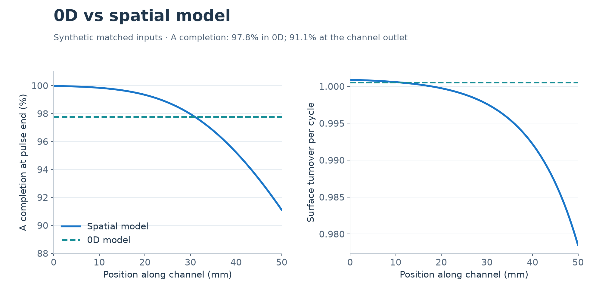
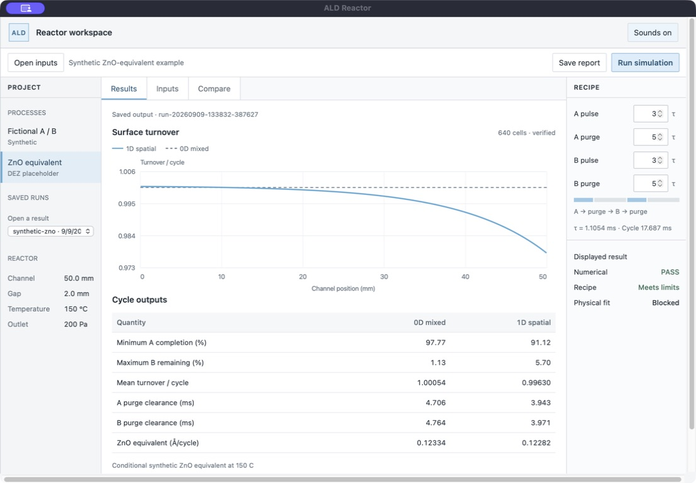
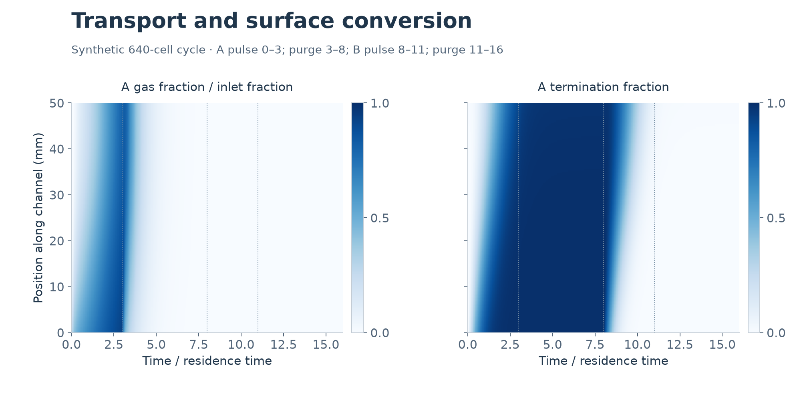
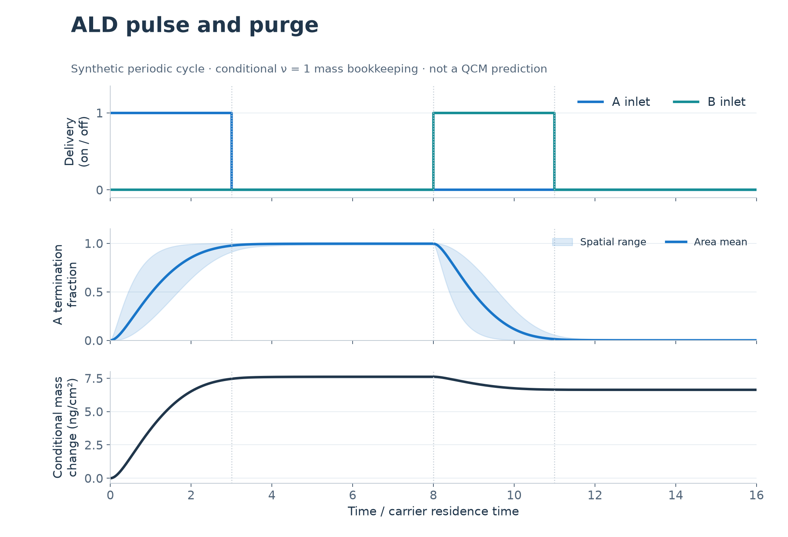

# ALD reactor digital twin

<p align="center"><a href="#overview">Overview</a> · <a href="#install">Install</a> · <a href="#usage">Usage</a> · <a href="#results">Results</a> · <a href="#limits">Limits</a> · <a href="#next-steps">Next steps</a> · <a href="#guides-and-sources">Guides and sources</a> · <a href="#license">License</a> · <a href="#terms">Terms</a></p>

I wanted to know whether the gas in an atomic layer deposition reactor really reaches the far end before the recipe switches precursors, and whether the purge really clears it. This project simulates that for a synthetic example and compares a simple well-mixed model with one that tracks the whole channel. It runs as a Mac app and from the command line.

## Key results

- In the synthetic example, the well-mixed model says 97.8% of the surface finishes the first half-reaction. The channel model says only 91.1% does at the outlet.
- In a larger study of 63 recipe and scenario pairs, every calculation passed its numerical checks, but no single recipe worked in every scenario.
- The ZnO example from DEZ and water predicts about 1.68 Å of film per cycle, close to the 1.65 Å reported at 150 °C. It also fails the model's own wall check.
- 22 Python tests cover the solver, which the app, the command line and the Python API all share.



## Overview

In atomic layer deposition you pulse one precursor into a reactor, purge it out, pulse the second one, and purge again. Each cycle adds a very thin slice of film. The hard part is knowing whether the gas actually reached the far end of the reactor before you switched, and whether the purge really cleared it.

This project follows the gas and the surface through every cycle. If you only ran the simple model, you would think the recipe was fine when the far end of the reactor was actually coming up short.

> [!NOTE]
> <sub>atomic layer deposition (ALD): building a film one thin layer per cycle · precursor: gas that carries the film's atoms · purge: flushing gas out of the reactor · half-reaction: one precursor reacting with the surface · 0D model: treats the reactor as one well-mixed volume · spatial model: tracks gas along the channel</sub>

## Install

The Mac app is a zip you download and open.

[Download for Mac](https://github.com/mehnajjimy/ald-reactor-digital-twin/releases/download/v1.0.0/ALD-Reactor-1.0.0-macOS-arm64.zip) · [Install guide](docs/install.md)

The app has only been tested on Apple Silicon Macs. It isn't notarized by Apple, so macOS will block it the first time. The install guide shows how to open it anyway.



To run from source you need Python 3.12. On macOS or Linux:

```sh
python3.12 -m venv .venv
.venv/bin/python -m pip install -r requirements-lock.txt
.venv/bin/python -m pip install --no-build-isolation --no-deps -e .
.venv/bin/ald-twin gui
```

I've only tested the Mac app on my own machine, and Windows builds aren't verified. [Installation](docs/installation.md) and the [desktop guide](docs/desktop-guide.md) cover setup and builds.

Sources: docs/install.md, docs/installation.md, docs/desktop-guide.md, pyproject.toml, requirements-lock.txt

## Usage

Run an example from the command line:

```sh
.venv/bin/ald-twin inspect synthetic-ab
OPENBLAS_NUM_THREADS=1 VECLIB_MAXIMUM_THREADS=1 .venv/bin/ald-twin simulate synthetic-ab --output runs/first-ab
.venv/bin/ald-twin compare runs/first-ab
```

The app, the CLI and the Python API all use the same solver. Every run saves its inputs, results and a hash of the code that made them, so you can always tell where a number came from. The fictional A/B example only reports surface turnover, since there's no real film to convert it into.

Sources: src/ald_twin/, docs/worked-examples.md, docs/input-reference.md

## Results

> [!IMPORTANT]
> Two of the examples use made-up numbers to test the math. The third, ZnO from DEZ and water, uses published estimates plus a couple of assumptions. None of them has been checked against real experiments yet.

> [!NOTE]
> <sub>completion: share of the surface that reacts in a half-reaction · turnover: completed surface cycles per site, each cycle · outlet: the far end of the channel · QCM: quartz crystal microbalance, a way to weigh a film as it grows · Péclet number: how much faster flow carries gas than diffusion spreads it · DEZ: diethylzinc · ZnO: zinc oxide · Å: angstrom, a ten-billionth of a meter</sub>

### Model comparison

The well-mixed model is too optimistic. In the synthetic example it says 97.8% of the surface finishes the first half-reaction, while the channel model says only 91.1% does at the outlet.



The heatmap shows precursor transport and surface conversion along the channel over one cycle.

[How the figures were made](docs/readme-figures.md)

Sources: docs/media/model-comparison.png, docs/media/provenance.json, docs/readme-figures.md, scripts/render_readme_figures.py

### Cycle behavior

One cycle shows A and B delivery, how the surface converts, and a conditional mass response. These plots come from one saved simulation. The mass trace is what the model predicts, not real QCM data.



[How the figures were made](docs/readme-figures.md)

Sources: docs/media/ald-cycle.png, docs/media/synthetic-cycle.npz, docs/media/provenance.json, docs/readme-figures.md

### Recipe study

Beyond the example at the top, I also ran a bigger study of 63 recipe and scenario pairs. Every calculation passed its numerical checks, but no single recipe worked in every scenario. Nine older high-Péclet cases and one capacity point are still unverified.

> [!IMPORTANT]
> The math being right doesn't mean a working recipe exists.

[Full analysis](docs/recipe-study.md)

Sources: docs/model-limits.md, docs/process-study-plan.md

### DEZ example

DEZ (diethylzinc) used to be a placeholder with numbers picked to make the math convenient. `dez-water-zno` swaps those for published estimates, and every value lists its source and how uncertain it is. It predicts about 1.68 Å of ZnO per cycle, close to the 1.65 Å reported at 150 °C.

> [!WARNING]
> How likely DEZ and water are to react when they hit the surface is a guess. I couldn't find a published number for either one, so the file says "assumed".

The run takes about 13 minutes, and the example is in the source code but not in the 1.0.0 app download yet. It also fails the model's own wall check, because DEZ takes too long to spread across the 2 mm gap. The model still gives a number, but it flags the recipe as outside the range it trusts.

```sh
OPENBLAS_NUM_THREADS=1 VECLIB_MAXIMUM_THREADS=1 .venv/bin/ald-twin simulate dez-water-zno --output runs/dez
```

[Full analysis](docs/dez-example.md) · [Input reference](docs/input-reference.md#the-dez-and-water-estimates)

Sources: src/ald_twin/processes/dez-water-zno.json, docs/input-reference.md, tests/test_dez_estimates.py

## Limits

- None of the examples has been checked against real experiments. Two use
  made-up numbers, and the DEZ example still assumes both reaction probabilities.
- The 97.8% against 91.1% gap at the top comes from synthetic inputs. It's a
  model result that I haven't measured on a real reactor.
- The Mac app has only been tested on Apple Silicon, and Windows builds aren't
  verified.

## Next steps

- A faster DEZ demo, so the app shows a result in under a minute
- Temperature dependence, so it can run below 150 °C
- Easier custom precursor inputs and documented reactor dimensions

Other films, including silicon-based ones, would each need their own chemistry and transport checks first. For now the app is for offline simulation and comparison.

## Guides and sources

- [Inputs](docs/input-reference.md): units, assumptions and what counts as a pass
- [Examples](docs/worked-examples.md): changing recipes and comparing saved runs
- [Code guide](docs/code-guide.md): how a calculation runs, line by line
- [Adding a process](docs/adding-a-process.md): what you can change and what you can't
- [Releases](docs/release-guide.md): builds and the update check
- [Recipe study](docs/recipe-study.md), [DEZ example](docs/dez-example.md) and [model limits](docs/model-limits.md)

[References](docs/references.md) lists the scientific sources, and [third-party notices](THIRD_PARTY_NOTICES.md) cover dependencies and assets. Use [CITATION.cff](CITATION.cff) if you want to cite it. The 22 Python tests run in [CI](https://github.com/mehnajjimy/ald-reactor-digital-twin/actions/workflows/tests.yml).

## License

The code and docs are under the [MIT license](LICENSE).

## Terms

- ALD (atomic layer deposition): building a film one thin layer per cycle
- Precursor: a gas that carries the atoms of the film
- Purge: flushing the gas out of the reactor between pulses
- Half-reaction: one precursor reacting with the surface
- 0D model: treats the reactor as one well-mixed volume
- Spatial model: tracks gas and surface along the whole channel
- Completion: the share of the surface that reacts in a half-reaction
- Turnover: completed surface cycles per site, each cycle
- Péclet number: how much faster flow carries gas than diffusion spreads it
- DEZ: diethylzinc, the zinc precursor
- ZnO: zinc oxide, the film
- QCM (quartz crystal microbalance): a way to weigh a film as it grows
- Å (angstrom): a ten-billionth of a meter
- CLI: command line interface
